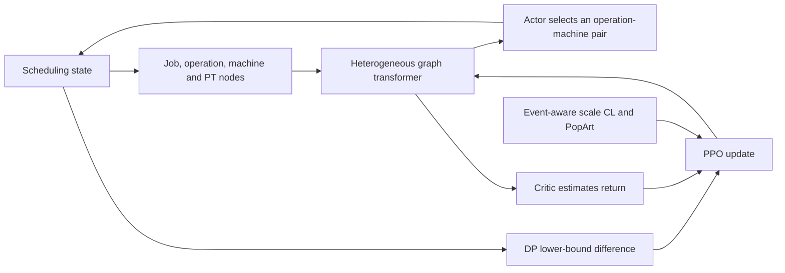
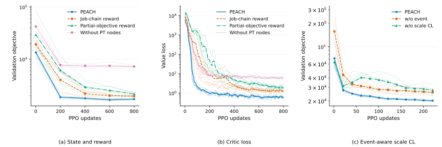

# PEACH for Dynamic Flexible Job Shop Scheduling

Implementation and reproducibility package for *Heterogeneous Graph With Admissible-Bound Reward Shaping for Reinforcement Learning in Dynamic Flexible Job Shop Scheduling*.

PEACH represents operation-machine processing times with dedicated PT nodes, learns with differences of an admissible dynamic-programming lower bound, and uses event-aware scale curriculum learning (scale CL) with PopArt normalization.



## Quick start

Use Python 3.12 and [uv](https://docs.astral.sh/uv/). Run from this repository's root. The lock pins the dependencies; select a compatible PyTorch build for GPU training.

```bash
uv sync --locked
uv run python -m verification.verify_release
OMP_NUM_THREADS=1 CUDA_VISIBLE_DEVICES='' uv run python evaluation/infer.py \
  --model models/checkpoints/generalization-scale-cl-10x5-s42.pth \
  --size 10x5 --seed 42 --device cpu
```

The last command schedules a new generated example on CPU. To inspect an exact paper input, use `evaluation/infer.py --archive static --list_cases`, then `--archive static --case <case-id> --inspect_fixture`. Remove `--inspect_fixture` to schedule that input.

## Train and evaluate

| Experiment | Entrypoint | Controls and selected policies |
| :-- | :-- | :-- |
| Component and scale CL ablations | [Component training](training/ablation_training_stability.py), [PEACH training](training/train_graph_rl.py) | [35 runnable presets](training/presets/README.md), Dim16/Layer3, five seeds |
| Static scalability and generalization | [Static evaluation](evaluation/exp_scale_stress_test.py) | Five `generalization-scale-cl-*` policies, Dim128/Layer4 |
| Priority Shock and Capacity Shock | [Dynamic evaluation](evaluation/exp_large_scale_dispatching.py) | Shared `generalization-scale-cl-100x20-s42` policy |
| Public SD1/SD2 benchmark | [Static training](training/train_single_obj.py), [evaluation](evaluation/exp_single_obj.py) | Eight `appendix-sd*` policies, Dim128/Layer4 |
| Return variance | [Moment and condition checks](verification/variance.py), [recomputation](analysis/reproduce.py) | Retained policy/random trajectories, Dim128/Layer4 |

[models/manifest.json](models/manifest.json) maps all 57 selected checkpoints to source identities, seeds and checksums. [experiments/configs/manifest.json](experiments/configs/manifest.json) indexes their recorded configurations. These configuration records describe the completed experiments; runnable training inputs are [training/settings.json](training/settings.json) and the ablation presets.

```bash
uv run python training/train_graph_rl.py --disable_wandb --print_config
uv run python training/train_graph_rl.py \
  --settings training/presets/cl_peach_s42.json \
  --experiment_name peach-s42 --disable_wandb
```

The generic defaults use the compact model. Historical main policies have different initialization and training protocols.

## Recompute the paper statistics

```bash
uv run python -m analysis.reproduce --output outputs/reproduced
uv run python -m analysis.plot_ablation \
  --input outputs/reproduced/ablations.json --output outputs/reproduced/ablation.svg
```

These commands validate retained schedules and recompute all five experiment families without training or running a solver. [results/manifest.json](results/manifest.json) pins the exact inputs, event schedules and records. New executions can differ from historical results; missing historical validation inputs remain unknown.



Thin lines show individual training seeds; thick lines show their means. Critic loss uses a trailing 20-update mean. Curriculum curves use the common matched prefix through update 221.

## Citation and attribution

The manuscript is unpublished. [CITATION.cff](CITATION.cff) records its authors and title without asserting submission or acceptance. The original [copyright notice](LICENSE) is retained. SD1/SD2 and DANIEL reference attribution is in [data/benchmarks/daniel/README.md](data/benchmarks/daniel/README.md); no external paper PDFs are distributed.
